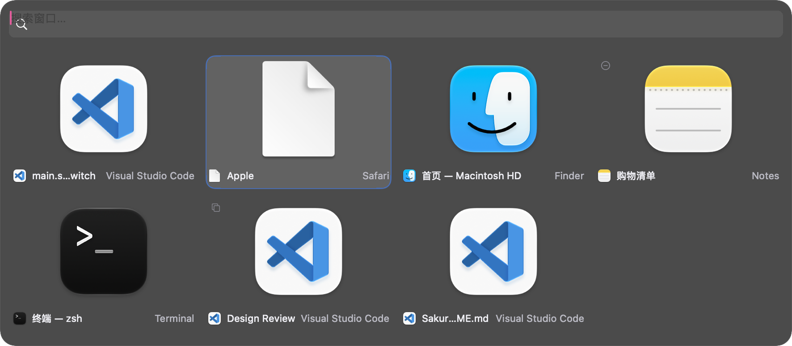
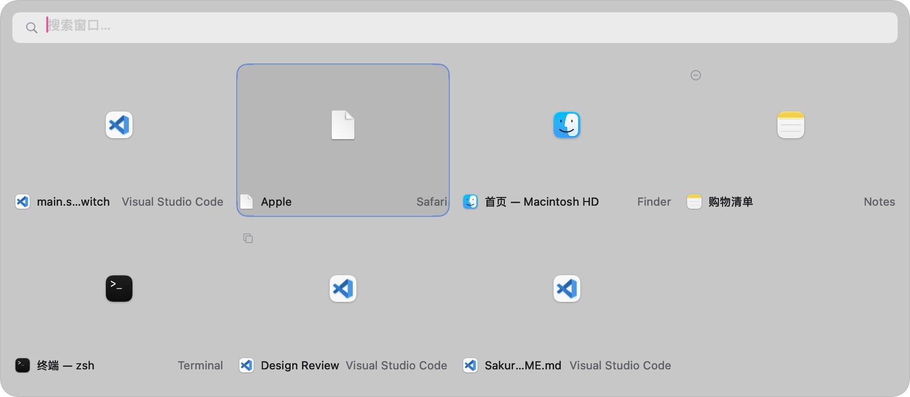
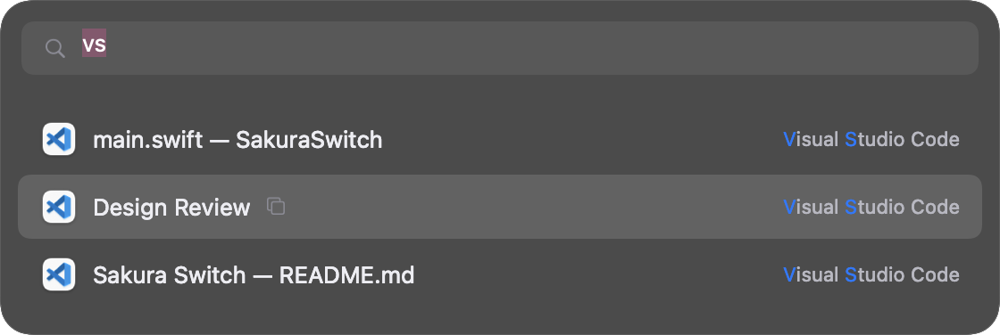
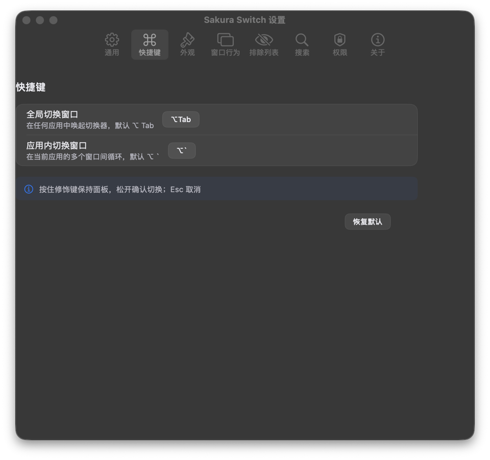

# 🌸 Sakura Switch

**Sakura Switch** is an open-source macOS window switcher — a lightweight Alt-Tab
replacement that lists *windows* (not just apps) with fuzzy search, live thumbnails and
keyboard-first navigation, wrapped in a native, frosted-glass UI.

> 将窗口（而非应用）作为切换单位的 macOS 窗口切换器。按住 `⌥ Tab` 唤起，键入即搜，
> 回车切换 —— 像原生系统的一部分。

## v1.1.0 使用指南

[下载 DMG](https://github.com/yueseqaz/sakura-switch/releases/download/v1.1.0/SakuraSwitch.dmg) ·
[下载 ZIP](https://github.com/yueseqaz/sakura-switch/releases/download/v1.1.0/SakuraSwitch.zip) ·
[更新日志](CHANGELOG.md)

- 按住 **Option**，每按一次 **Tab** 选择下一个窗口；**Shift+Tab** 反向选择。
- 在 **设置 → 快捷键 → 松开修饰键时**，选择「切换并关闭面板」或「保留面板打开」。
  保留面板后，可继续按 Tab、方向键浏览，按 Enter 或点击缩略图切换，按 Esc 取消。
- 选中某个窗口后停留约 **0.52 秒**，自动显示大预览；继续按 Tab 即收起并重新计时。
- 应用图标旁显示窗口数量；鼠标停在应用图标上，可浏览该应用的窗口。
  点击「全部窗口」返回完整列表；在应用分组中按 Esc 也可返回。
- 缩略图和大预览按原窗口宽高比等比缩放，保留竖向、横向和超宽窗口的形状。
- 更新后如果系统开关已开但 App 仍提示未授权，请按下文的权限恢复步骤重新添加当前版本。

<p align="center">
  
</p>
<p align="center">
  
</p>
<p align="center">
  
</p>
<p align="center">
  
</p>

*Screenshots from the initial release: frosted-glass appearances, search with match
highlighting, and settings. v1.1.0 adds the application strip and variable window proportions.*

## Features

- **Window-level switching** — every window of every regular app, not aggregated by app.
- **Global hotkey** `⌥ Tab` (customizable) and **in-app cycle** `⌥ \`` (customizable).
- **Hold to browse, release to switch** — keep the modifier held, tap the key or use
  arrows / `Tab` to browse, release the modifier to confirm. Hold `Option` and tap
  `Tab` repeatedly to cycle; add `Shift` to reverse. `Esc` cancels.
- **Release behavior** — Settings → Hotkeys lets you choose whether releasing the
  modifier switches and closes the panel, or leaves the selected window and panel
  open for another action.
- **Three view modes** — live window thumbnails, app icons, or a compact title list.
- **Browse by application** — hover an app in the icon strip to see all its window
  thumbnails and click a window to switch. Window counts appear beside each app;
  select **All windows** or press `Esc` to return to the full list.
- **Enlarged window preview** — stop on a selected window for a moment to see a
  much larger, sharper preview. It follows keyboard selection rather than mouse
  hover; pressing Tab again dismisses it and the grid stays in place.
- **Natural thumbnail proportions** — each window preview follows that window's
  own aspect ratio, so portrait and landscape windows are not forced into one
  shared rectangle.
- **MRU ordering** — most-recently-used first, persisted across launches.
- **Fuzzy search** — type anywhere, match against app name, window title and bundle ID;
  subsequence matching (`vs` → *Visual Studio Code*), app-name weighting, character highlight,
  plus a persistent **search memory** so your abbreviations keep getting smarter.
- **Quick actions on the selected window** —
  `⌘W` close · `⌘M` minimize · `⌘F` toggle fullscreen · `⌘Q` quit app ·
  `⌘H` hide app · `⌘R` reveal in Finder · `⌘,` settings.
- **State badges** — minimized, fullscreen, other-Space windows are marked and still switchable.
- **Multi-display aware** — panel follows the mouse screen; optional per-screen filtering.
- **Thumbnails** — ScreenCaptureKit on macOS 14+, `CGWindowListCreateImage` fallback on
  macOS 13; cached with a 5-second TTL; degrades gracefully to app icons without permission.
- **Native minimal UI** — frosted-glass panel, light & dark appearance, 中文 / English.
- **100% command-line build** — no `.xcodeproj`, ad-hoc signing by default, no private APIs.

## System Requirements

- macOS **13.0** (Ventura) or newer — Apple Silicon & Intel.
- Accessibility permission (required) and Screen Recording permission (optional, thumbnails only).

## Installation

1. Download `SakuraSwitch.dmg` (or `SakuraSwitch.zip`) from the
   [latest release](https://github.com/yueseqaz/sakura-switch/releases).
2. Open the DMG and drag **Sakura Switch** into *Applications*.

### ⚠️ App without Developer ID — first launch

Sakura Switch is a community app, **ad-hoc signed** by default (no Apple Developer certificate, no notarization).
Gatekeeper may block the first launch:

- Right-click `Sakura Switch.app` → **Open** → **Open** in the dialog; *or*
- Double-click it once, then go to **System Settings → Privacy & Security**, scroll down and
  click **Open Anyway**.

This is expected for apps without Developer ID signing and notarization. You can also build it yourself from source
(instructions below), which many users prefer.

### 🔐 Permissions

| Permission | Required | Why |
|---|---|---|
| **Accessibility** | ✅ required | To enumerate and raise other apps' windows via the Accessibility API. The switcher will not appear until it is granted. |
| **Screen Recording** | optional | Only needed for window thumbnails. Without it you still get app icons. |

> **Permissions after updates:** the build script signs the complete app bundle, but ad-hoc signing
> does not provide a persistent identity across rebuilds. Recompiling or replacing the app may
> invalidate existing grants. Keep one installed copy in `/Applications`. If a grant stops working,
> quit the app, remove its old entry from **System Settings → Privacy & Security → Accessibility**,
> then add the installed app again. On newer macOS versions this pane may be called
> **Device Control & Data Access**.
> Sakura Switch re-checks Accessibility on every invocation and refreshes the permissions page
> automatically. Screen Recording may require an app restart after granting access.

**恢复更新后的授权 / Recover permissions after an update:**

1. Quit Sakura Switch and eject its installer disk image. Keep one installed copy
   in `/Applications` and reopen that copy.
2. In **System Settings → Privacy & Security → Accessibility** (or **Device Control
   & Data Access**), remove the old Sakura Switch entry, add the installed app and enable it.
3. Repeat for **Screen Recording / Screen & System Audio Recording** if thumbnails
   remain unavailable. Restart Sakura Switch if macOS requests it.
4. Open **Settings → Permissions** in Sakura Switch to verify both statuses.

The default ad-hoc signature can change on each build, so grants may need renewal
after later updates too. A persistent signing identity can be set when building below.

## Build from Source

Requirements: macOS 13+, Xcode Command Line Tools (`xcode-select --install`), Swift 5.9+.

```bash
git clone https://github.com/yueseqaz/sakura-switch.git
cd sakura-switch
swift build -c release
bash scripts/build-app.sh   # uses VERSION (currently 1.1.0)
open build/SakuraSwitch.app
```

The script assembles `build/SakuraSwitch.app` from the SwiftPM build product, signs the entire bundle,
and verifies its signature. Quit any running copy of this build before packaging; the script refuses
to replace a running app to avoid invalidating its code identity in memory. No Xcode project is involved.
To use a persistent signing identity from
your keychain instead of ad-hoc signing:

```bash
CODE_SIGN_IDENTITY="Apple Development: Your Name (TEAMID)" bash scripts/build-app.sh
```

For a distributable artifact:

```bash
bash scripts/package-dmg.sh   # uses VERSION; produces build/SakuraSwitch.dmg + .zip
```

## Development & Testing

```bash
swift build          # debug build
swift test           # test suite (core logic only)
```

If a Command Line Tools-only installation reports that the `TestingMacros` plugin
cannot be found, load its bundled plugin explicitly:

```bash
swift test -Xswiftc -load-plugin-library \
  -Xswiftc "$(xcode-select -p)/usr/lib/swift/host/plugins/testing/libTestingMacros.dylib"
```

Tests use Apple's [Swift Testing](https://developer.apple.com/xcode/swift-testing/)
framework (`import Testing`) instead of XCTest — XCTest is unavailable on
Command Line Tools-only machines, and this project is committed to building
with plain `swift build` / `swift test` (no Xcode required).

UI / AX behaviors that cannot be covered by unit tests are tracked in
[`docs/manual-test.md`](docs/manual-test.md).

A debug-only self test renders the switcher panel with synthetic windows,
handy for UI work without an Accessibility grant:

```bash
swift run SakuraSwitch --self-test                 # screenshot + quit
swift run SakuraSwitch --self-test --self-test-search "vs"   # scripted search
swift run SakuraSwitch --self-test --self-test-app com.microsoft.VSCode  # app group
swift run SakuraSwitch --self-test --self-test-live          # real windows; requires permissions
swift run SakuraSwitch --self-test --self-test-live --self-test-app com.apple.finder --self-test-interactions --self-test-selection-preview
```

The interaction check exercises repeated Tab presses, wrapping, reverse navigation,
the Carbon hotkey fallback and menu modifier release. Selection-preview mode also
saves the enlarged preview to `/tmp/sakura-selection-preview-selftest.png`. Automatic captures do not
take keyboard focus; add `--self-test-stay` for interactive testing.

## Project Layout

```
Sources/SakuraSwitchCore/    # core logic library (permissions, AX, MRU, search, settings…)
Sources/SakuraSwitch/        # executable: AppKit entry, panel & settings UI
Tests/SakuraSwitchCoreTests/ # Swift Testing suite for the core library
scripts/                     # build-app.sh / package-dmg.sh / make-icon.swift
Resources/                   # AppIcon.icns (generated by scripts/make-icon.swift)
docs/                        # manual-test checklist
.github/workflows/           # CI (build.yml) & release (release.yml)
```

> **Note on the UI stack:** the interface is pure AppKit
> (NSVisualEffectView, NSSwitch, NSTabViewController, CGEvent taps) — the
> most native look and behavior, and no dependency on SwiftUI property
> wrapper macros, which keeps the project buildable with Command Line
> Tools alone.

## Contributing

Issues and pull requests are welcome!

1. Fork the repository and create a feature branch.
2. Keep changes compiling with `swift build` and covered by `swift test`.
3. Open a PR against `main`. CI must pass.

Please keep the code style consistent (Swift 5 language mode, no external dependencies in the
core library) and document user-visible changes in `CHANGELOG.md`.

## Known Limitations

- **No Developer ID or notarization by default** — triggers Gatekeeper on first launch (see above) and may require
  re-granting Accessibility after rebuilds.
- **Cross-Space switching** is subject to macOS restrictions — windows on other desktops are
  listed and marked, and the system performs the space transition; edge cases may behave
  differently from a signed app.
- Thumbnails require Screen Recording permission; without it, app icons are shown instead.
- No private APIs are used; some deep system behaviors are therefore intentionally not attempted.

## License

[MIT](LICENSE) © 2026 yueseqaz
